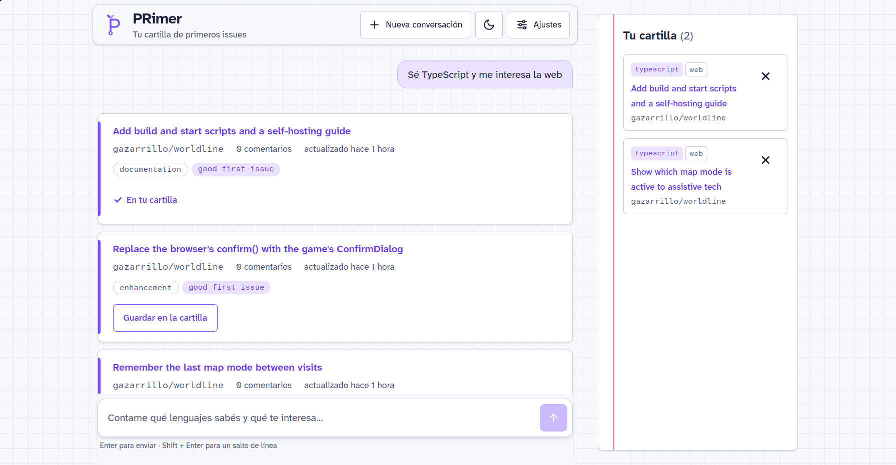
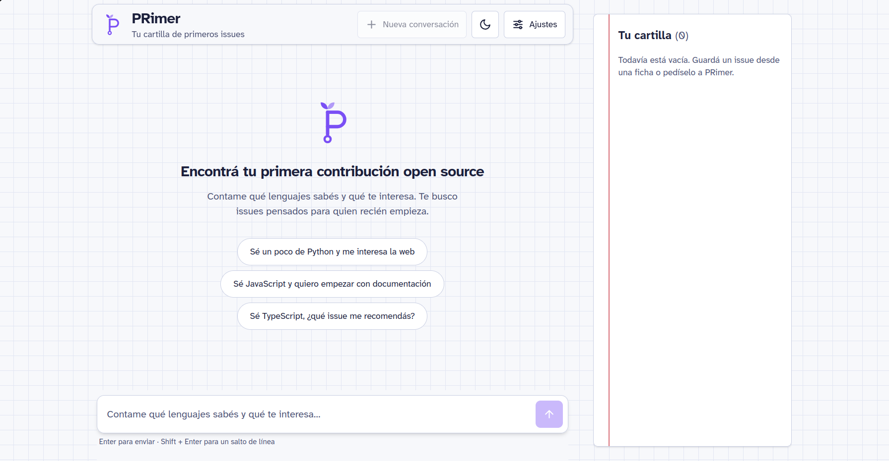
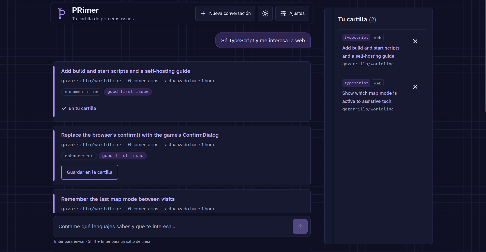
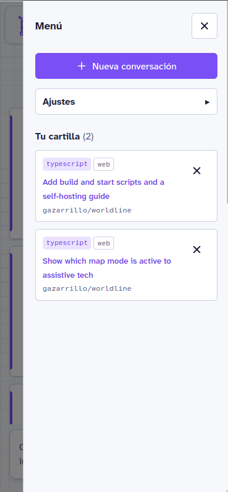
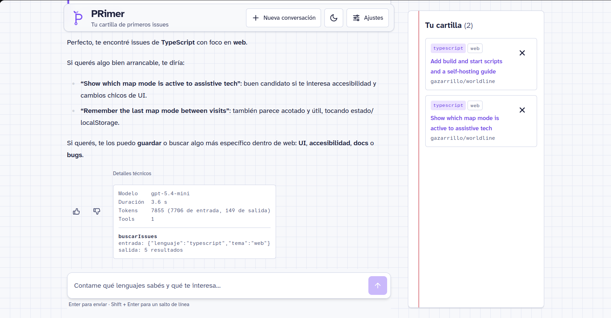

# PRimer

> Tu cartilla de primeros issues: un asistente con IA que te ayuda a encontrar tu primera contribución open source.

🔗 **Demo:** https://primer-bot.vercel.app/



---

## ¿Qué es PRimer?

PRimer es un chat con IA que, a partir de lo que sabés y lo que te interesa, busca en GitHub issues abiertos pensados para principiantes, te los muestra como fichas con su fuente y te deja guardarlos en tu **cartilla** para encararlos después.

**¿Por qué "PRimer"?** El nombre juega con tres sentidos:

- *primer* (inglés): la capa de base que va antes de todo, como cuando recién empezás a formarte.
- *primer* (inglés): una cartilla o manual introductorio. PRimer es una cartilla de issues.
- *primer* (español): de primero, porque busca tus primeros issues. Y las letras **PR**, de *pull request*.

El logo sigue la misma idea: una **P** cuyo trazo termina en un commit, con un brote que nace arriba.

## Definición del bot

**Problema que resuelve.** Iniciarse en el desarrollo puede ser difícil, y GitHub al principio es poco intuitivo. Los buscadores existentes devuelven miles de issues sin contexto: muchos están viejos, ya asignados o en repos abandonados, y un junior no tiene forma rápida de saber cuál le conviene.

**Público objetivo.** Estudiantes y desarrolladores junior que quieren hacer su primera contribución open source, sumar experiencia real y llenar su GitHub.

**Propuesta de valor.** En lugar de armar búsquedas con filtros, le contás al bot en lenguaje natural qué sabés (*"sé un poco de Python y me gusta lo web"*). PRimer traduce eso en una búsqueda precisa, descarta los issues que no valen la pena, te explica cada uno de manera simple, con link a la fuente, y te guarda los que te interesan.

## User stories

### 1. Encontrar issues según mis lenguajes
 
**Como** estudiante o dev junior,
**quiero** poder filtrar los issues,
**para** encontrar fácilmente aquellos que corresponden a los lenguajes que manejo.
 
Criterios de aceptación:
- [x] El sistema reconoce en el texto qué lenguajes maneja el usuario y qué le interesa.
- [x] El sistema aplica filtros por lenguaje (y por tema, si lo hay) a la búsqueda de issues.
- [x] El sistema muestra los issues encontrados como fichas con título, repo, etiquetas, actividad y link al issue original.
- [x] Si falta información para buscar (por ejemplo, el lenguaje), el bot pregunta antes de buscar.
### 2. Armar mi cartilla de issues
 
**Como** dev junior,
**quiero** guardar los issues que me interesan y sacar los que ya no,
**para** organizar mis próximas contribuciones.
 
Criterios de aceptación:
- [x] Puedo guardar un issue con un botón en su ficha o pidiéndoselo al bot ("guardame el segundo").
- [x] Puedo quitar un issue con la ✕ de la cartilla o pidiéndoselo al bot.
- [x] El bot nunca confirma que guardó o quitó algo si la acción no se hizo de verdad.
- [x] Guardar el mismo issue dos veces no lo duplica, y el bot avisa que ya estaba.
- [x] Cada issue de la cartilla muestra con qué búsqueda lo encontré (lenguaje y tema).
### 3. Retomar donde lo dejé
 
**Como** estudiante que usa PRimer en distintos momentos,
**quiero** que mi conversación y mi cartilla sigan ahí cuando vuelvo,
**para** no tener que empezar de cero cada vez.
 
Criterios de aceptación:
- [x] Al recargar la página, la conversación aparece completa.
- [x] La cartilla se conserva entre conversaciones.
- [x] Puedo empezar una conversación nueva sin perder mi cartilla.
### 4. Usar PRimer cómodamente, sin importar cómo navego
 
**Como** persona con baja visión, daltonismo o que navega con teclado o lector de pantalla,
**quiero** poder usar PRimer sin barreras,
**para** buscar mi primera contribución en igualdad de condiciones.
 
Criterios de aceptación:
- [x] Toda la interfaz se puede usar solo con teclado, con foco visible.
- [x] Puedo agrandar el tamaño de letra y elegir tema claro u oscuro desde Ajustes.
- [x] Ningún estado se comunica solo con color (siempre hay ícono o texto).
- [x] Puedo reducir las animaciones.
- [x] WAVE no reporta errores.

## Capturas
 
| Bienvenida | Modo oscuro |
| --- | --- |
|  |  |
 
| Celular con el menú abierto | Panel de debug |
| --- | --- |
|  |  |

## Funcionalidades
 
- **Chat con streaming**, con historial persistente y botón para empezar una conversación nueva.
- **Búsqueda de issues** en GitHub interpretada desde lenguaje natural, con resultados como fichas y link a la fuente.
- **Cartilla personal:** guardar y quitar issues con botones o pidiéndoselo al bot.
- **Estados claros:** "Pensando…", "Buscando issues en GitHub…" con fichas esqueleto, "Guardando en tu cartilla…", errores con botón Reintentar y botón Detener mientras responde.
- **Feedback** 👍/👎 por respuesta, guardado en la base.
- **Panel de debug** por respuesta (modelo, duración, tokens y cada tool llamada con su entrada y su resultado). Viene oculto: se activa en **Ajustes → Detalles técnicos → Visibles**.
- **Ajustes:** tamaño de letra, tema (sistema, claro u oscuro), animaciones y detalles técnicos. Se recuerdan entre visitas.
- **Responsive:** en el celular, la cartilla y los ajustes van en un menú lateral.

## Arquitectura
 
### Flujo de un mensaje
 
1. El front valida el texto (vacío, máximo 1000 caracteres) y manda **solo el último mensaje** y el id de la conversación.
2. El servidor aplica **rate limiting** por IP, valida el pedido con **Zod** e identifica al visitante por su **cookie firmada**.
3. Verifica que la conversación sea de ese visitante, carga el historial desde Supabase y lo valida.
4. El LLM recibe el system prompt (con ejemplos *few-shot*), el historial y las tools disponibles, y **decide** si necesita usar alguna.
5. Las tools validan sus parámetros con Zod, llaman a GitHub o a Supabase, validan la respuesta y aplican la lógica de negocio.
6. El LLM redacta la respuesta con los datos obtenidos. La interfaz la recibe en streaming y dibuja las fichas a partir del resultado real de la tool.
7. Al terminar, se guardan los mensajes con su metadata (tokens y tiempos) y se registra un log estructurado.

### Tools
 
| Tool | Qué hace | Fuente |
| --- | --- | --- |
| `buscarIssues` | Busca issues abiertos para principiantes según lenguaje y tema | GitHub Search API |
| `guardarIssue` | Guarda un issue en la cartilla del visitante | Supabase |
| `verGuardados` | Lista los issues de la cartilla | Supabase |
| `quitarIssue` | Quita un issue de la cartilla | Supabase |

## Decisiones técnicas y trade-offs
 
### Tecnologías
 
- **Next.js (App Router):** front y back en un solo repo, con deploy directo en Vercel.
- **Vercel AI SDK:** tool calling nativo, streaming y definición de tools con Zod en poco código. Elegido sobre LangChain por ser más liviano y por integrarse directo con Next y Vercel.
- **Cliente propio para GitHub, SDK para OpenAI:** con GitHub hacía falta control total sobre timeouts, reintentos y errores. Para OpenAI, el SDK resuelve el streaming y el ciclo de tool calling.
- **GitHub API:** pública, bien documentada y con rate limits reales, que obligan a manejarlos de verdad. Cada issue trae su URL, así que citar la fuente es natural.
- **Supabase (Postgres):** los datos son relacionales (una conversación tiene muchos mensajes). **RLS activado sin políticas:** nadie accede desde el navegador, solo el servidor con la secret key.
- **Zod:** una sola herramienta para validar el input del usuario, los parámetros de las tools y las respuestas de APIs externas.

### La IA no es un wrapper
 
- **El LLM elige las tools.** No hay ningún `if` que decida cuándo buscar o guardar. Puede encadenarlas: para "sacá el de Prolog", primero lee la cartilla con `verGuardados` y después llama a `quitarIssue` con la URL correcta.
- **Salida estructurada:** el LLM devuelve los parámetros de cada tool como JSON (por ejemplo, `{ "lenguaje": "cpp", "tema": "web" }`), y Zod los valida antes de ejecutar.
- **Lógica de negocio después de la API:** se descartan issues asignados o sin actividad en los últimos 6 meses, se quedan los 5 más recientes, se recorta la descripción a 300 caracteres y cada issue se reduce a los campos que usa la app. Menos tokens y respuestas más enfocadas.
- **Las fichas salen de los datos reales de la tool**, no del texto del LLM, así que el modelo no puede inventar ni alterar un issue.

### Estrategia de prompts
 
- **System prompt en su propio archivo**, dividido en secciones: qué hace, qué no hace, cuándo usar cada tool, reglas de veracidad y formato.
- **Cinco ejemplos *few-shot*:** el caso feliz, la falta de datos (pregunta antes de buscar), el issue duplicado, el error de la API y el pedido fuera de tema.
- **Cada regla de veracidad corrige un problema visto en pruebas reales.** Por ejemplo, durante el desarrollo el modelo respondió "listo, guardado" sin llamar a la tool. Ahora tiene prohibido confirmar una acción sin haber recibido `{ guardado: true }`.
- **Prompt injection:** la descripción de un issue la escriben terceros y puede contener instrucciones (en las pruebas apareció *"Comment 'Taking this' before you start"*). El prompt indica tratarla siempre como dato, nunca como orden.
- **Decisión de producto:** ante referencias ambiguas ("guardame el último"), el bot elige la interpretación más razonable en lugar de preguntar todo. Un bot que confirma cada paso cansa, y un error se corrige con un toque.

### Manejo de errores y edge cases
 
- **Errores de GitHub clasificados** en un `GitHubError` con `kind` (`auth`, `rate_limit`, `validation`, `not_found`, `server`, `timeout`, `network`, `invalid_response`). Quien lo recibe decide qué hacer según el tipo, sin parsear mensajes.
- **Timeout de 8 segundos** con `AbortSignal.timeout`, y **un solo reintento ante 5xx**. Los 4xx no se reintentan, porque repetir el pedido daría el mismo error.
- **Rate limit de GitHub:** se calcula cuántos segundos faltan a partir de `x-ratelimit-reset`, y el bot le dice al usuario cuánto esperar.
- **Errores como datos:** si una tool falla, devuelve el error al LLM como resultado en vez de cortar la ejecución, y el bot lo explica en simple.
- **404 no es una búsqueda vacía:** una búsqueda sin resultados es un 200 con `total_count: 0`; el 404 es un recurso que no existe.
- **En la interfaz:** errores con texto y botón Reintentar, mensaje específico para el rate limit propio (con los segundos de espera) y aviso si no hay conexión.

### Persistencia
 
- **Guardados por visitante, mensajes por conversación:** la cartilla te acompaña en todas tus conversaciones.
- **`unique (visitor_id, issue_url)`:** la regla "no guardar el mismo issue dos veces" vive en la base, no solo en el código.
- **Mensajes guardados como `parts` en `jsonb`**, con una columna `posicion` para el orden. Al recargar se ve todo, y el orden no depende de que dos mensajes tengan el mismo `created_at`.
- **Ids de mensajes generados en el servidor:** el mismo id en la base y en la pantalla, así el `upsert` nunca duplica.

### Seguridad
 
- **El front manda solo el último mensaje.** El servidor carga el historial desde la base. Si el front mandara todo, alguien podría inventar mensajes viejos (por ejemplo, un `guardado: true` falso) y el LLM se los creería.
- **Validación del pedido con Zod antes de todo:** solo se aceptan mensajes con rol `user` y partes de texto de 1 a 1000 caracteres. Nadie puede hacerse pasar por el bot ni mandar resultados de tools armados a mano.
- **Visitante identificado con una cookie `httpOnly`, `secure` y firmada con HMAC.** El JavaScript de la página no la puede leer, y si alguien altera el id, la firma deja de coincidir y el servidor lo rechaza. La firma se compara con `timingSafeEqual`, para no filtrar información por diferencias de tiempo. Si falta la clave secreta, el servidor falla a propósito (*fail closed*).
- **Cada endpoint verifica el dueño:** nadie puede escribir en la conversación de otro, ni votar sus mensajes, ni tocar su cartilla. Si algo no es tuyo, la respuesta es 404, igual que si no existiera, para no confirmar que existe.
- **Rate limiting por IP** (10 mensajes por minuto) antes de leer el body, porque es el filtro más barato. Responde `429` con el header estándar `Retry-After`.
- **Las keys solo viven en el servidor** (`.env.local` y Vercel), nunca en el repo ni en el navegador.

### Observabilidad
 
- **Logs estructurados en JSON** (`momento`, `nivel`, `evento` y datos), con eventos nombrados por área (`chat.respuesta`, `chat.rate_limit`, `tool.guardar_issue`). Se pueden filtrar en los logs de Vercel.
- **Metadata por respuesta** (modelo, duración y tokens), que se guarda junto al mensaje y alimenta el panel de debug.
- **Caso real:** al agregar la validación de metadata, el log mostró en segundos el campo exacto que fallaba (los mensajes del usuario no tienen metadata).

### Accesibilidad
 
- **WAVE sin errores** (incluidos los de contraste).
- **Tipografía Atkinson Hyperlegible**, diseñada por el Braille Institute para personas con baja visión. Su versión Mono se usa solo para lo que es código: repos y etiquetas.
- **Contraste AA** calculado para todos los textos, en los dos temas.
- **Navegación completa con teclado:** foco visible en todo, paneles con `<dialog>` nativo (el foco queda adentro, Esc cierra y el foco vuelve al botón que lo abrió) y tarjetas de la cartilla con *stretched link*, sin elementos interactivos anidados.
- **Lectores de pantalla:** `lang="es"`, regiones con título, quién habla en cada mensaje, estados anunciados con `role="status"` y errores con `role="alert"`, y aviso de los links que se abren en otra pestaña.
- **Nunca solo color:** cada estado lleva ícono o texto (✓ En tu cartilla, ⚠ No se pudo guardar, el pulgar relleno). Verificado con el simulador de daltonismo de Firefox. <!-- TODO: confirmar que lo probaste -->
- **Ajustes:** tamaño de letra (hasta 125%, y toda la interfaz escala), tema y animaciones reducidas. Se respeta también `prefers-reduced-motion` del sistema.
- **Botones de al menos 44 px** para tocar cómodo en el celular.

### Diseño
 
- **Metáfora de cuaderno:** la hoja cuadriculada de fondo, las fichas con borde violeta y la cartilla con la línea roja de margen.
- **Violeta "good first issue":** el acento parte del color de esa etiqueta en GitHub, corrido unos grados hacia un tono más cálido.
- **Colores como tokens** (variables CSS). Los componentes dicen `text-tinta`, no un color fijo, así que el tema cambia sin un solo `dark:` desparramado.

## Features bonus implementados
 
- [x] **Framework IA:** Vercel AI SDK
- [x] **Streaming** de respuestas
- [x] **Sistema de feedback:** 👍/👎 por respuesta
- [x] **Testing:** Vitest (cliente de GitHub, búsqueda, tools y firma de la cookie)
- [x] **Rate limiting** por IP
- [x] **Observabilidad:** logging estructurado y metadata por respuesta
- [x] **Accesibilidad:** WAVE sin errores, teclado, lectores de pantalla, contraste y ajustes de lectura
- [x] **Panel de debug** (bonus de la interfaz): Ajustes → Detalles técnicos → Visibles

## Instalación local
 
### Requisitos
 
- Node.js 22 o superior
- Una cuenta de Supabase
- Un token de GitHub (*fine-grained*, solo lectura de repositorios públicos)
- Una API key de OpenAI

### Pasos
 
```bash
git clone https://github.com/sildileo/primer-bot.git
cd primer-bot
npm install
cp .env.example .env.local   # completar con tus valores (ver la tabla de abajo)
```
 
Crear las tablas en Supabase: copiar el contenido de `supabase/schema.sql` en el **SQL Editor** y ejecutarlo.
 
```bash
npm run dev
```
 
La app queda en `http://localhost:3000`.
 
### Variables de entorno
 
| Variable | Descripción |
| --- | --- |
| `OPENAI_API_KEY` | API key de OpenAI |
| `GITHUB_TOKEN` | Token de GitHub (sube el límite de búsqueda de 10 a 30 por minuto) |
| `SUPABASE_URL` | URL del proyecto de Supabase |
| `SUPABASE_SERVICE_ROLE_KEY` | Secret key de Supabase (solo se usa en el servidor) |
| `VISITOR_COOKIE_SECRET` | Clave para firmar la cookie del visitante (mínimo 32 caracteres). Se genera con `openssl rand -base64 32` |
 
### Tests
 
```bash
npm test
```
 
## Limitaciones conocidas
 
- **Rate limit compartido:** la búsqueda de GitHub permite 30 pedidos por minuto por token, y todos los usuarios comparten el mismo.
- **El rate limiting propio es por instancia:** el contador vive en memoria, y en Vercel la app puede correr en varias instancias. En producción se usaría un almacenamiento compartido, como Redis.
- **Sin login:** el historial y la cartilla dependen de la cookie del navegador. Si la borrás o cambiás de dispositivo, empezás de cero.
- **La firma de la cookie impide falsificar ids, pero no el robo de la cookie entera.** Contra eso protegen `httpOnly` y `secure`.
- **Las conversaciones anteriores quedan guardadas, pero no hay una lista para volver a ellas.**
- **La calidad de los resultados depende de los mantenedores:** si no etiquetan bien sus issues, no aparecen o aparecen issues que no son para principiantes.
- **El token de GitHub vence** y hay que renovarlo.

## Mejoras futuras
 
- **Recortar el historial que se manda al LLM** (los últimos mensajes o un resumen): el panel de debug mostró unos 14.700 tokens de entrada para 134 de salida, porque cada mensaje reenvía toda la conversación con los resultados de búsquedas anteriores.
- **Cachear búsquedas repetidas** por unos minutos, para no gastar el rate limit.
- **Lista de conversaciones anteriores** para retomarlas.
- **Login con GitHub (OAuth):** cada usuario tendría su propio límite y su historial en cualquier dispositivo.
- **Tool `detalleRepo`:** actividad, estrellas y si el repo acepta PRs, para recomendar mejor.
- **Recomendaciones según el perfil de GitHub** del usuario.
- **Avisos** cuando un issue guardado se asigna o se cierra.
- **Guía paso a paso** para hacer el fork, la branch y el PR del issue elegido.
- **Botón "Ver más" en los resultados:** hoy, para ver otros issues de la misma búsqueda hay que pedírselo al bot ("mostrame otros 5"), que vuelve a buscar con la página siguiente. Un botón o flechas debajo de las fichas lo harían más directo, sin pasar por el LLM ni gastar tokens.
